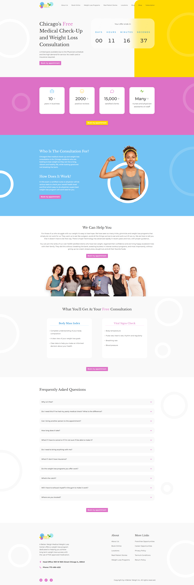
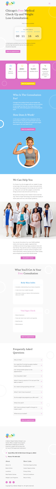
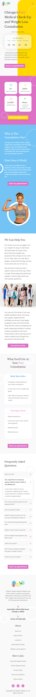

<div align="center">

# A Better Weigh

**Responsive landing page for a medical weight-loss center, built from a Figma design.**

[](https://valenberdev.github.io/alpha-efficiency-test/)


<sub>Alpha Efficiency · Web Developer test task</sub>

</div>

---

## Preview

<p align="center">
  
</p>

<table>
  <tr>
    <td align="center" valign="top"><b>Tablet · 820px</b></td>
    <td align="center" valign="top"><b>Mobile · 375px</b></td>
  </tr>
  <tr>
    <td align="center" valign="top"></td>
    <td align="center" valign="top"></td>
  </tr>
</table>

---

## The brief

| Requirement                                | How it is solved                                                                                                                                                                                                        |
| ------------------------------------------ | ----------------------------------------------------------------------------------------------------------------------------------------------------------------------------------------------------------------------- |
| Responsive from 1920px down to 320px       | Mobile-first CSS with breakpoints at 768px and 1200px, matching the three Figma frames (375, 820, 1920). No horizontal scroll at any width.                                                                             |
| Burger menu with navigation list           | Accessible disclosure menu driven by `aria-expanded`. Closes on link click, outside click, `Escape` and when reaching the desktop layout.                                                                               |
| Working countdown                          | Counts down to the next Monday at 00:00 local time. Remaining time is computed from `Date.now()` on every tick, so it never drifts and recovers after a background tab. It rolls over to the following week by itself.  |
| FAQ dropdown with lorem ipsum              | Accordion with animated height, one item open at a time, `aria-expanded` and `aria-controls` on every question.                                                                                                         |
| Good UX details                            | See [UX details](#ux-details).                                                                                                                                                                                          |
| Responsive background and ring decorations | Rings scale with the viewport and sit behind the content. Where a full-opacity ring would meet white text, its position is adjusted. The faint ring in the "Who" section is allowed to pass behind the first paragraph. |

---

## Beyond the brief

- **Sticky glass header.** Transparent over the hero, turns into a blurred translucent bar on scroll and shrinks slightly.
- **Count-up stats.** The numbers in the stats strip animate once when they enter the viewport.
- **Ring drift.** Background rings move slowly with a GPU-only `transform` animation.
- **Art direction.** `<picture>` serves a different photo on desktop and on mobile/tablet. Images are WebP and lazy loaded.
- **Sharing metadata.** Open Graph and Twitter cards, favicon and theme color.

---

## UX details

- **Hover only where it exists.** Hover effects run inside `@media (hover: hover)`, so nothing gets stuck after a tap on touch screens. Pressed states cover touch.
- **Keyboard focus.** Focus ring with at least 3:1 contrast on every section background, plus a skip link.
- **Touch targets.** Footer links and social icons have a 44px hit area, enlarged with an invisible pseudo-element so the design is untouched.
- **No dead links.** Placeholder links (`href="#"`) do not jump to the top. They show a short notice instead.
- **Touch polish.** No grey tap flash, no double-tap zoom on buttons, no accidental text selection on the FAQ.
- **Reduced motion.** Count-up and ring animations are disabled for users who prefer reduced motion.
- **FAQ readability.** The open item lifts into a white card with a divider between question and answer.
- **Layout stability.** Tabular numbers keep the stats from shifting width while they count.
- On screens under 768px, opening a FAQ question scrolls it to about 30% of the viewport height, so the answer is fully readable. Questions already in a comfortable position do not move, and users with reduced motion get an instant scroll instead of an animated one.

---

## Decisions and deviations

| Topic                       | Decision                                                                                                                                            | Why                                                                                                                                                                                                                                                                                                        |
| --------------------------- | --------------------------------------------------------------------------------------------------------------------------------------------------- | ---------------------------------------------------------------------------------------------------------------------------------------------------------------------------------------------------------------------------------------------------------------------------------------------------------- |
| Breakpoints                 | 768px and 1200px                                                                                                                                    | Each Figma frame (375, 820, 1920) has its own layout, and everything in between degrades without overflow.                                                                                                                                                                                                 |
| Countdown                   | Targets next Monday 00:00, local time                                                                                                               | The brief asks for a countdown to "a specific number". A weekly deadline keeps every unit meaningful, with days going from 6 to 0. The design mockup shows `00` days, so the first hours of the week look different from the static frame.                                                                 |
| Color contrast              | White text on pink, yellow and blue, and pink or blue accents on white, kept from the design                                                        | Several combinations do not reach WCAG AA: buttons, headings and paragraphs on colored sections, the blue card titles, the countdown labels, the white social icons on pink and the pink FAQ chevron. I kept the Figma palette for fidelity. Darker brand tones would be the fix and need design sign-off. |
| Tablet FAQ                  | Questions are at least 44px tall                                                                                                                    | Figma uses 38px. I chose a usable touch target over exact fidelity.                                                                                                                                                                                                                                        |
| "Who" section ring          | Shifted away from the text on narrow widths                                                                                                         | The original position overlapped white text on a white ring.                                                                                                                                                                                                                                               |
| Mobile footer               | Centered below 768px                                                                                                                                | A deliberate departure from the left-aligned frame, kept to mobile only.                                                                                                                                                                                                                                   |
| Placeholder links           | Intentionally not connected                                                                                                                         | The brief provides no destinations.                                                                                                                                                                                                                                                                        |
| Fonts                       | Libre Baskerville and Montserrat from Google Fonts                                                                                                  | As specified in the design.                                                                                                                                                                                                                                                                                |
| Links without a destination | Book Online, Blog, Shop, Subscription, footer legal links, social icons and the mobile "See patient stories" button show a short "Demo link" notice | The brief has no target pages for them, so they are placeholders. The "Book my appointment" buttons call the clinic phone number instead.                                                                                                                                                                  |

---

## Lighthouse

Measured locally with Chromium and simulated throttling, so the numbers are indicative and not PageSpeed results.

|                | Mobile | Desktop |
| -------------- | ------ | ------- |
| Performance    | 94     | 100     |
| Accessibility  | 96     | 96      |
| Best practices | 100    | 100     |
| SEO            | 100    | 100     |

The only accessibility audit that does not pass is color contrast, which is a documented decision above.

---

## Project structure

```
.
├── index.html
├── css/
│   └── styles.css
├── js/
│   ├── menu.js         burger menu
│   ├── header.js       glass state on scroll
│   ├── countdown.js    live countdown
│   ├── counters.js     stats count-up
│   ├── faq.js          accordion
│   └── links.js        placeholder link notice
├── assets/
│   └── img/            WebP and SVG assets
└── docs/               previews used in this README
```

---

## Run locally

No build step and no dependencies. Open `index.html` in a browser, or serve the folder:

```bash
npx serve .
```

---

<div align="center">
  <sub>Built by <a href="https://github.com/valenberdev">Valentino Berdini</a></sub>
</div>
